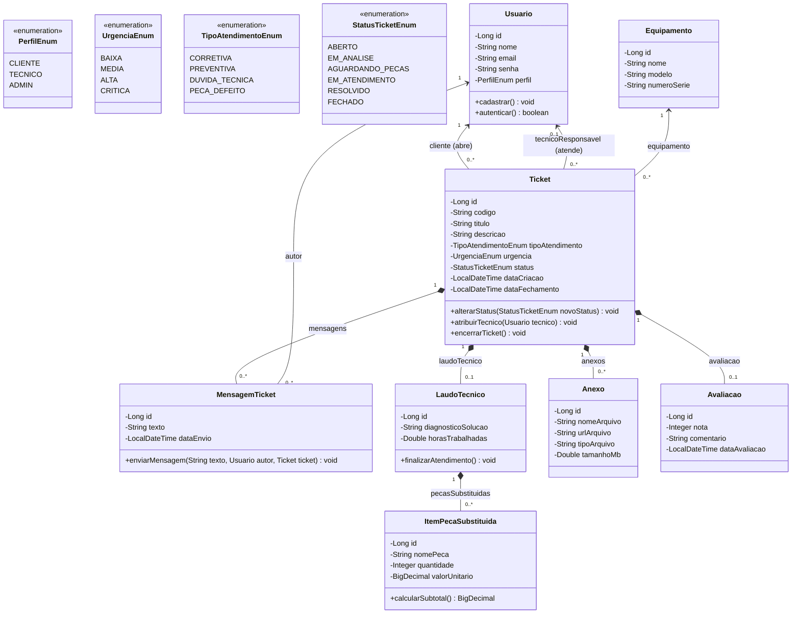

# CENTRO UNIVERSITÁRIO CATÓLICA DE SANTA CATARINA
## CURSO DE BACHARELADO EM ENGENHARIA DE SOFTWARE
### DISCIPLINA: PROGRAMAÇÃO WEB — 5ª FASE

---

# PROJETO FINAL – ETAPA 1: BACKEND, MODELAGEM E REQUISITOS
### SISTEMA ASTEC (GESTÃO DE ASSISTÊNCIA TÉCNICA)

---

## IDENTIFICAÇÃO DA EQUIPE
**Integrantes:**
- **Agenor Alvise — Líder**
- **Felipe Santos**
- **Henrique Cezar da Silveira**

**Link do GitHub:** *A definir*

---

## 1. Visão Geral do Projeto

### 1.1 Nome do Produto
**Sistema Astec**

### 1.2 Declaração do Problema e Justificativa
A **AGE Máquinas e Manutenção LTDA** necessita centralizar o registro e acompanhamento das solicitações de assistência técnica, atualmente realizadas por diferentes canais, como telefone, e-mail e WhatsApp. 

Essa descentralização dificulta a organização, o acompanhamento, o controle de prazos de atendimento (SLA) e o histórico dos atendimentos prestados a cada máquina ou cliente. 

O sistema **Gestão de Assistência Técnica (Sistema Astec)** propõe centralizar esse processo em uma aplicação web moderna, permitindo o registro padronizado de chamados, acompanhamento de status em tempo real, registro de laudos com peças substituídas e histórico de interações, proporcionando maior organização, rastreabilidade e eficiência no atendimento.

### 1.3 Público-Alvo e Objetivos do Sistema
O sistema será destinado principalmente a:
- **Clientes da AGE Máquinas:** responsáveis pela abertura, envio de fotos/vídeos e acompanhamento de solicitações de assistência técnica de seus equipamentos.
- **Administradores e técnicos:** responsáveis pelo gerenciamento, triagem, atendimento de campo, lançamento de laudos e encerramento dos chamados.

**Objetivo Geral:**  
Desenvolver um sistema web para centralizar e organizar o gerenciamento das solicitações de assistência técnica da AGE Máquinas, permitindo o registro, acompanhamento e atualização dos chamados.

**Objetivos Específicos:**
- Permitir o cadastro e gerenciamento de clientes e de seus equipamentos industriais;
- Permitir a abertura de chamados de assistência técnica e a consulta dos mesmos com filtros dinâmicos;
- Permitir a atualização do status, registro de interações (chat interno) e consulta do histórico;
- Manter as informações armazenadas de forma estruturada e relacional através de persistência com Spring Data JPA.

---

## 2. Especificação de Requisitos

### 2.1 Requisitos Funcionais (RF)
- **RF01 - Abertura de Chamado:** O cliente pode abrir um ticket escolhendo o equipamento/máquina, o tipo de atendimento (corretiva, preventiva, dúvida técnica, peça com defeito), título, descrição da falha e nível de urgência.
- **RF02 - Anexo de Mídias:** O cliente e o técnico podem anexar fotos do equipamento, vídeos curtos do problema e documentos em PDF (como manuais).
- **RF03 - Atribuição de Técnico:** O gestor pode visualizar a fila de chamados pendentes e atribuir um técnico ou equipe para cada ticket.
- **RF04 - Status do Chamado:** O sistema deve controlar o fluxo do chamado pelos status: Aberto, Em Análise, Aguardando Peças, Em Atendimento, Resolvido e Fechado.
- **RF05 - Chat/Histórico do Ticket:** Aba de mensagens dentro do próprio chamado para troca de informações e histórico entre cliente e técnico.
- **RF06 - Notificações:** Envio de e-mails ou alertas automáticos quando houver troca de status, novas mensagens ou nova atribuição no chamado.
- **RF07 - Painel do Cliente:** Tela para o cliente listar e buscar apenas os seus próprios chamados com filtros por status, data e máquina.
- **RF08 - Painel do Técnico/Admin:** Tela central para a equipe de suporte e gestores visualizarem e filtrarem todos os chamados da empresa.
- **RF09 - Laudo Técnico e Peças:** O técnico registra a solução aplicada, tempo gasto de trabalho e peças trocadas no encerramento.
- **RF10 - Avaliação do Atendimento:** O cliente pode dar nota (estrelas) e deixar um comentário sobre o atendimento após a resolução.
- **RF11 - Reabertura de Ticket:** O cliente pode reabrir um chamado encerrado em até 7 dias caso o problema no mesmo equipamento volte a acontecer.

### 2.2 Requisitos Não Funcionais (RNF)
- **RNF01 - Tempo de Carregamento:** O carregamento das telas e a atualização de status devem responder em no máximo 1,5 segundos.
- **RNF02 - Disponibilidade:** O sistema de chamados deve rodar 24 horas por dia, 7 dias por semana (uptime mínimo de 99,5%).
- **RNF03 - Controle de Acesso:** Clientes só enxergam os próprios chamados, enquanto técnicos e administradores têm acesso amplo conforme o perfil (RBAC).
- **RNF04 - Histórico e Auditoria:** Todas as trocas de status, atribuições e edições devem gerar logs imutáveis para auditoria.
- **RNF05 - Limite de Anexos:** Cada arquivo anexado pode ter no máximo 20 MB e deve passar por verificação de segurança antes do envio.
- **RNF06 - Acesso Mobile:** A interface deve ser responsiva e funcionar perfeitamente em celulares e tablets para os técnicos de campo.
- **RNF07 - Controle de SLA:** Configuração de prazos máximos de primeira resposta e solução definitiva de acordo com a urgência do chamado.
- **RNF08 - Proteção de Dados (LGPD):** Guardar dados de contato e históricos de atendimento respeitando integralmente a LGPD.
- **RNF09 - Padrões de Integração (API RESTful):** O backend deve ser projetado sob a arquitetura REST (JSON), garantindo comunicação padronizada.

---

## 3. Arquitetura e Modelagem de Dados

### 3.1 Diagrama de Classes UML

---

### 3.2 Mapeamento de Entidades JPA e Dicionário de Dados

#### Dicionário de Dados

##### Tabela: `tb_usuario`
| Campo | Tipo | Restrição | Descrição |
|---|---|---|---|
| id | BIGINT | PK, Auto Inc | Identificador único do usuário. |
| nome | VARCHAR(255) | Not Null | Nome completo. |
| email | VARCHAR(255) | Unique, Not Null | E-mail para login. |
| senha | VARCHAR(255) | Not Null | Hash da senha. |
| perfil | VARCHAR(50) | Not Null | Nível de acesso (CLIENTE, TECNICO, ADMIN). |

##### Tabela: `tb_equipamento`
| Campo | Tipo | Restrição | Descrição |
|---|---|---|---|
| id | BIGINT | PK, Auto Inc | Identificador único. |
| nome | VARCHAR(255) | Not Null | Nome do equipamento. |
| modelo | VARCHAR(255) | | Modelo do equipamento. |
| numeroSerie | VARCHAR(100) | Unique | Número de série para controle. |

##### Tabela: `tb_ticket`
| Campo | Tipo | Restrição | Descrição |
|---|---|---|---|
| id | BIGINT | PK, Auto Inc | Identificador único do chamado. |
| codigo | VARCHAR(50) | Unique, Not Null | Protocolo gerado para o cliente (ex: AST-20261001). |
| titulo | VARCHAR(255) | Not Null | Resumo do problema. |
| descricao | TEXT | Not Null | Descrição detalhada da falha. |
| tipoAtendimento | VARCHAR(50) | Not Null | Corretiva, Preventiva, etc. |
| urgencia | VARCHAR(50) | Not Null | Baixa, Média, Alta, Crítica. |
| status | VARCHAR(50) | Not Null | Situação atual do chamado. |
| dataCriacao | TIMESTAMP | Not Null | Data e hora de abertura. |
| dataFechamento | TIMESTAMP | | Data e hora de resolução. |
| cliente_id | BIGINT | FK, Not Null | Referência a tb_usuario (perfil Cliente). |
| tecnico_id | BIGINT | FK | Referência a tb_usuario (perfil Tecnico). |
| equipamento_id | BIGINT | FK, Not Null | Referência a tb_equipamento. |

##### Tabela: `tb_mensagem_ticket`
| Campo | Tipo | Restrição | Descrição |
|---|---|---|---|
| id | BIGINT | PK, Auto Inc | Identificador único da mensagem. |
| texto | TEXT | Not Null | Conteúdo da mensagem (chat). |
| dataEnvio | TIMESTAMP | Not Null | Data e hora da postagem. |
| ticket_id | BIGINT | FK, Not Null | Referência ao ticket ao qual pertence. |
| autor_id | BIGINT | FK, Not Null | Referência a tb_usuario (quem enviou). |

##### Tabela: `tb_laudo_tecnico`
| Campo | Tipo | Restrição | Descrição |
|---|---|---|---|
| id | BIGINT | PK, Auto Inc | Identificador do laudo. |
| diagnosticoSolucao | TEXT | Not Null | O que foi diagnosticado e feito pelo técnico. |
| horasTrabalhadas | DOUBLE | | Tempo gasto no reparo. |
| ticket_id | BIGINT | FK, Unique, Not Null | Referência de 1:1 com tb_ticket. |

##### Tabela: `tb_item_peca`
| Campo | Tipo | Restrição | Descrição |
|---|---|---|---|
| id | BIGINT | PK, Auto Inc | Identificador da peça. |
| nomePeca | VARCHAR(255) | Not Null | Nome da peça trocada. |
| quantidade | INT | Not Null | Quantidade utilizada. |
| valorUnitario | DECIMAL(10,2) | Not Null | Custo de cada peça. |
| laudo_tecnico_id | BIGINT | FK, Not Null | Referência ao laudo que consumiu a peça. |

##### Tabela: `tb_anexo`
| Campo | Tipo | Restrição | Descrição |
|---|---|---|---|
| id | BIGINT | PK, Auto Inc | Identificador do anexo. |
| nomeArquivo | VARCHAR(255) | Not Null | Nome original do arquivo. |
| urlArquivo | VARCHAR(500) | Not Null | Caminho no Storage/S3. |
| tipoArquivo | VARCHAR(50) | | Extensão (jpg, pdf, mp4). |
| tamanhoMb | DOUBLE | | Tamanho para validação de limite. |
| ticket_id | BIGINT | FK, Not Null | Referência ao ticket de origem. |

##### Tabela: `tb_avaliacao`
| Campo | Tipo | Restrição | Descrição |
|---|---|---|---|
| id | BIGINT | PK, Auto Inc | Identificador da avaliação. |
| nota | INT | Not Null | Nota de 1 a 5 estrelas. |
| comentario | VARCHAR(500) | | Feedback em texto. |
| dataAvaliacao | TIMESTAMP | Not Null | Quando a nota foi dada. |
| ticket_id | BIGINT | FK, Unique, Not Null | Referência de 1:1 com tb_ticket. |

---

## 4. Testes de Repositório Automatizados (Spring Data JPA)

Foram implementados testes de unidade e integração na classe `PesquisasRepositoryTest`, validando:
- Buscas customizadas por chaves alternativas (E-mail, Número de Série);
- Filtragens relacionais (`findByClienteId`, `findByEquipamentoId`, `findByStatus`);
- Agregações com projeção DTO via JPQL (`contarTicketsPorEquipamento`, `contarTicketsPorStatus`);
- Métodos de contagem derivada (`countByStatus`, `countByEquipamento`);
- Cálculos de subtotal e integridade de laudos e peças trocadas.
