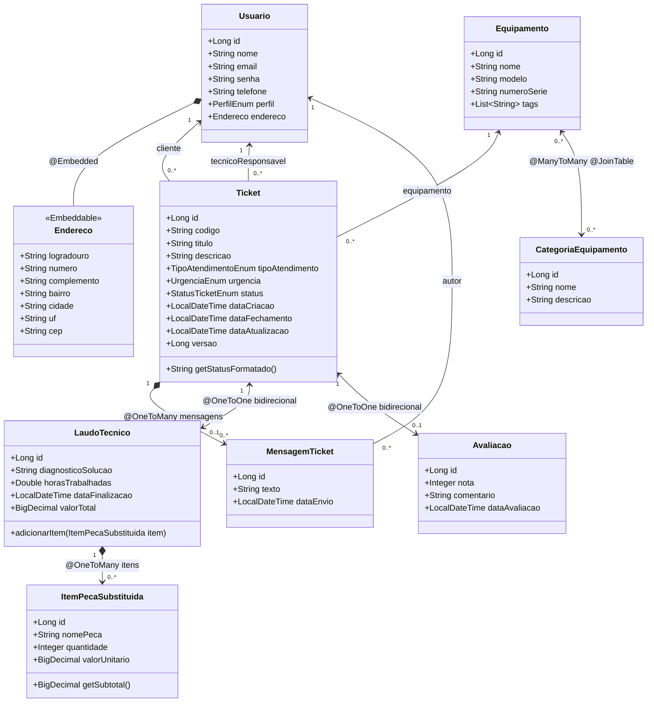

# SISTEMA ASTEC - GESTÃO DE ASSISTÊNCIA TÉCNICA INDUSTRIAL
## Documentação Oficial do Projeto Final de Programação WEB
**Instituição:** Centro Universitário - Católica de Santa Catarina  
**Curso:** Engenharia de Software / Sistemas de Informação  
**Disciplina:** Programação WEB  
**Professor:** Leonardo Vitazik Neto  
**Tecnologias:** Java 17, Spring Boot 3.3.4, Spring MVC, Thymeleaf, Spring Data JPA, Hibernate, Bean Validation, OpenAPI 3.0 (Swagger UI), Bootstrap 4.6.0, H2 Database.

---

## 1. Visão Geral do Projeto

### 1.1 Nome do Projeto
**Sistema Astec** – Plataforma Web Integrada para Gestão de Ordens de Serviço, Chamados Técnicos, Inventário de Maquinários e Manutenção Preventiva/Corretiva.

### 1.2 O Problema e a Justificativa
Empresas industriais e assistências técnicas especializadas sofrem com gargalos operacionais gerados pela descentralização de informações: chamados anotados em papéis, laudos técnicos extraviados, controle manual de peças substituídas e ausência de histórico de falhas por equipamento.
Essa falta de rastreabilidade ocasiona atrasos críticos em linhas de produção fabris, elevação de custos de garantia e insatisfação generalizada de clientes industriais.

O **Sistema Astec** soluciona esse problema ao disponibilizar uma plataforma web robusta e transacional, implementada sob a arquitetura clássica e segura do **Spring MVC** com renderização do lado do servidor (**SSR via Thymeleaf**), persistência relacional avançada com **Spring Data JPA** e documentação interativa com **OpenAPI 3.0 / Swagger UI**.

### 1.3 Público-Alvo e Objetivos do Sistema
- **Clientes / Indústrias Solicitantes:** Cadastram solicitações de reparo ou manutenção preventiva, acompanham o status da Ordem de Serviço em tempo real, interagem via chat com os técnicos e realizam a avaliação do atendimento prestado.
- **Técnicos de Campo / Oficina:** Visualizam a fila de atendimento priorizada por urgência, atualizam o andamento do chamado, emitem laudos periciais e discriminam peças/componentes substituídos com cálculo de subtotais.
- **Gestores e Administradores:** Monitoram indicadores de desempenho (tickets abertos, em atendimento, resolvidos e fechados), analisam equipamentos com maior índice de quebras via agregações JPQL e gerenciam o parque instalado.

---

## 2. Especificação de Requisitos

### 2.1 Requisitos Funcionais (RF)

| ID | Requisito Funcional | Ator Primário | Regras de Negócio e Descrição |
|:---|:---|:---|:---|
| **RF01** | Painel Geral (Dashboard) | Todos | Apresentar métricas quantitativas de chamados por status e listagem paginada com ordenação decrescente por data. |
| **RF02** | Filtro Dinâmico de Chamados | Todos | Permitir a busca combinada e flexível de chamados por status, urgência e termo no título (Criteria Specification). |
| **RF03** | Abertura de Novo Chamado | Cliente / Admin | Registrar novo ticket exigindo título (5-150 car.), descrição, cliente solicitante, equipamento e nível de urgência com Bean Validation. |
| **RF04** | Detalhamento de Chamado | Todos | Exibir todos os dados do ticket, cliente (com endereço embutido), equipamento (com tags e categorias), versão de concorrência e metadados. |
| **RF05** | Transição de Status | Técnico / Admin | Atualizar o ciclo de vida do chamado (`ABERTO` &rarr; `EM_ATENDIMENTO` &rarr; `RESOLVIDO` &rarr; `FECHADO` ou `CANCELADO`). |
| **RF06** | Histórico de Mensagens (Chat) | Cliente / Técnico | Trocar mensagens em ordem cronológica vinculadas unicamente àquele chamado. |
| **RF07** | Emissão de Laudo Técnico | Técnico | Registrar diagnóstico pericial, horas trabalhadas e peças substituídas com cálculo automático de subtotais e total do laudo. |
| **RF08** | Avaliação do Atendimento | Cliente | Permitir que o cliente atribua nota (1 a 5 estrelas) e parecer textual após o chamado ser marcado como resolvido. |
| **RF09** | Gestão de Equipamentos | Admin / Técnico | Listar todos os equipamentos com suas categorias (@ManyToMany) e tags técnicas (@ElementCollection). |
| **RF10** | Cadastro de Equipamento | Admin / Técnico | Cadastrar novos maquinários com nome, modelo, número de série único, categorias associadas e tags. |
| **RF11** | API RESTful & Documentação | Sistemas / Desenvolvedores | Expor endpoints REST com semântica HTTP estrita (200, 201, 204, 404) documentados no Swagger UI (`/swagger-ui/index.html`). |

### 2.2 Requisitos Não Funcionais (RNF)

| ID | Categoria | Descrição Técnica | Métrica / Critério de Aceite |
|:---|:---|:---|:---|
| **RNF01** | Arquitetura | Monolito modular baseado em Spring MVC e Thymeleaf | Ausência de dependências client-side complexas (sem React/SPA); renderização SSR integral. |
| **RNF02** | Concorrência | Bloqueio Otimista (*Optimistic Locking*) com JPA | Campo anotado com `@Version` na entidade `Ticket` para evitar perdas por escrita concorrente. |
| **RNF03** | Integridade Relacional | Persistência transacional com Spring Data JPA | Transações delimitadas via `@Transactional` nos métodos de serviço para garantia ACID. |
| **RNF04** | Validação de Entrada | Bean Validation (JSR-380 / Hibernate Validator) | Validação em DTOs com mensagens internacionalizadas em `messages.properties`. |
| **RNF05** | Usabilidade & Responsividade | Framework CSS Bootstrap 4.6.0 | Layout fluido com CDN oficial, componentes modulares e fragmentos Thymeleaf reutilizáveis. |
| **RNF06** | Documentação de API | OpenAPI 3.0 / Springdoc OpenAPI Starter WebMVC | Interface gráfica Swagger UI acessível no endpoint padronizado `/swagger-ui/index.html`. |
| **RNF07** | Banco de Dados | H2 Database In-Memory | Banco relacional embarcado com console habilitado em `/h2-console` e suporte a DDL automático. |
| **RNF08** | Qualidade & Testabilidade | Testes automatizados com JUnit 5 e MockMvc | Cobertura integral das camadas Repository e Web Controller com 100% dos testes aprovados. |
| **RNF09** | Segurança & Desempenho | Paginação nativa com `Pageable` e projeções | Projeções em nível de banco de dados para otimização de tráfego de rede e consumo de memória. |

### 2.3 Matriz de Rastreabilidade

| Requisito | Entidades JPA Envolvidas | Métodos Spring Data / Service | Endpoint REST | View Thymeleaf (Spring MVC) |
|:---|:---|:---|:---|:---|
| **RF01** | `Ticket`, `Usuario`, `Equipamento` | `TicketRepository.countByStatus`, `findAll` | `GET /api/tickets` | `home.html` (`/home`) |
| **RF02** | `Ticket` | `TicketSpecification.comFiltros`, `findAll(spec, pageable)` | `GET /api/tickets` | `home.html` |
| **RF03** | `Ticket`, `Usuario`, `Equipamento` | `TicketService.criarTicket`, `save` | `POST /api/tickets` | `tickets/formulario.html` |
| **RF04** | `Ticket`, `Endereco`, `CategoriaEquipamento` | `TicketRepository.findById` | `GET /api/tickets/{id}` | `tickets/detalhes.html` |
| **RF05** | `Ticket` | `TicketService.alterarStatus` | `PATCH /api/tickets/{id}/status`| `tickets/detalhes.html` |
| **RF06** | `MensagemTicket`, `Ticket`, `Usuario` | `MensagemTicketRepository.save` | `GET /api/tickets/{id}` | `tickets/detalhes.html` |
| **RF07** | `LaudoTecnico`, `ItemPecaSubstituida` | `LaudoTecnicoRepository.save` | `GET /api/tickets/{id}` | `tickets/detalhes.html` |
| **RF08** | `Avaliacao`, `Ticket` | `AvaliacaoRepository.save` | `GET /api/tickets/{id}` | `tickets/detalhes.html` |
| **RF09** | `Equipamento`, `CategoriaEquipamento` | `EquipamentoRepository.findAll` | `GET /api/equipamentos` | `equipamentos/lista.html` |
| **RF10** | `Equipamento`, `CategoriaEquipamento` | `EquipamentoService.criarEquipamento` | `POST /api/equipamentos` | `equipamentos/formulario.html` |
| **RF11** | Todas | `TicketController`, `EquipamentoController` | Todos os `/api/*` | Swagger UI (`/swagger-ui/index.html`) |

---

## 3. Arquitetura e Modelagem de Dados

### 3.1 Diagrama de Classes UML (Mermaid)



### 3.2 Dicionário de Dados

#### Tabela `tb_usuario`
| Coluna | Tipo SQL | Restrições | Descrição |
|:---|:---|:---|:---|
| `id` | BIGINT | PK, AUTO_INCREMENT | Identificador primário do usuário |
| `nome` | VARCHAR(255) | NOT NULL | Nome completo |
| `email` | VARCHAR(255) | NOT NULL, UNIQUE | E-mail de autenticação e contato |
| `senha` | VARCHAR(255) | NOT NULL | Senha do usuário |
| `telefone` | VARCHAR(20) | NULL | Número de telefone/WhatsApp |
| `perfil` | VARCHAR(50) | NOT NULL | Papel no sistema (`ADMIN`, `TECNICO`, `CLIENTE`) |
| `end_logradouro` | VARCHAR(150) | NULL | Logradouro (@Embedded) |
| `end_numero` | VARCHAR(20) | NULL | Número predial (@Embedded) |
| `end_complemento`| VARCHAR(100) | NULL | Complemento residencial/comercial (@Embedded) |
| `end_bairro` | VARCHAR(80) | NULL | Bairro (@Embedded) |
| `end_cidade` | VARCHAR(80) | NULL | Município (@Embedded) |
| `end_uf` | VARCHAR(2) | NULL | Unidade Federativa (UF) (@Embedded) |
| `end_cep` | VARCHAR(10) | NULL | Código de Endereçamento Postal (@Embedded) |

#### Tabela `tb_equipamento`
| Coluna | Tipo SQL | Restrições | Descrição |
|:---|:---|:---|:---|
| `id` | BIGINT | PK, AUTO_INCREMENT | Identificador do equipamento |
| `nome` | VARCHAR(100) | NOT NULL | Nome/designação da máquina |
| `modelo` | VARCHAR(100) | NOT NULL | Modelo do fabricante |
| `numero_serie`| VARCHAR(100) | NOT NULL, UNIQUE | Número de série para rastreabilidade |

#### Tabela `tb_equipamento_tags` (@ElementCollection)
| Coluna | Tipo SQL | Restrições | Descrição |
|:---|:---|:---|:---|
| `equipamento_id` | BIGINT | FK -> `tb_equipamento(id)` | Chave estrangeira do equipamento |
| `tag` | VARCHAR(255) | NOT NULL | Tag/característica técnica embutida |

#### Tabela `tb_categoria_equipamento`
| Coluna | Tipo SQL | Restrições | Descrição |
|:---|:---|:---|:---|
| `id` | BIGINT | PK, AUTO_INCREMENT | Identificador da categoria |
| `nome` | VARCHAR(100) | NOT NULL, UNIQUE | Nome da categoria |
| `descricao` | VARCHAR(255) | NULL | Descrição da especialidade |

#### Tabela Associativa `tb_equipamento_categoria` (@JoinTable)
| Coluna | Tipo SQL | Restrições | Descrição |
|:---|:---|:---|:---|
| `equipamento_id` | BIGINT | PK, FK -> `tb_equipamento(id)` | Chave estrangeira para o equipamento |
| `categoria_id` | BIGINT | PK, FK -> `tb_categoria_equipamento(id)` | Chave estrangeira para a categoria |

#### Tabela `tb_ticket`
| Coluna | Tipo SQL | Restrições | Descrição |
|:---|:---|:---|:---|
| `id` | BIGINT | PK, AUTO_INCREMENT | Identificador sequencial do ticket |
| `codigo` | VARCHAR(255) | NOT NULL, UNIQUE | Código de rastreio alfanumérico (ex: `AST-20261001`) |
| `titulo` | VARCHAR(255) | NOT NULL | Título resumido da solicitação |
| `descricao` | TEXT | NOT NULL | Descrição detalhada do defeito ou demanda |
| `tipo_atendimento`| VARCHAR(50)| NOT NULL | `CORRETIVA`, `PREVENTIVA`, `DUVIDA_TECNICA`, `PECA_DEFEITO` |
| `urgencia` | VARCHAR(50) | NOT NULL | Nível de prioridade (`BAIXA`, `MEDIA`, `ALTA`, `CRITICA`) |
| `status` | VARCHAR(50) | NOT NULL | Ciclo de vida (`ABERTO`, `EM_ATENDIMENTO`, `RESOLVIDO`, `FECHADO`) |
| `data_criacao` | TIMESTAMP | NOT NULL | Data e hora de abertura do chamado |
| `data_fechamento`| TIMESTAMP | NULL | Data e hora de encerramento |
| `data_atualizacao`| TIMESTAMP| NULL | Data da última alteração |
| `versao` | BIGINT | NOT NULL | Controle de Concorrência Otimista (`@Version`) |
| `cliente_id` | BIGINT | FK -> `tb_usuario(id)`, NOT NULL | Cliente solicitante |
| `tecnico_id` | BIGINT | FK -> `tb_usuario(id)`, NULL | Técnico responsável designado |
| `equipamento_id`| BIGINT | FK -> `tb_equipamento(id)`, NOT NULL | Equipamento objeto da manutenção |

#### Tabela `tb_mensagem_ticket`
| Coluna | Tipo SQL | Restrições | Descrição |
|:---|:---|:---|:---|
| `id` | BIGINT | PK, AUTO_INCREMENT | Identificador da mensagem |
| `texto` | TEXT | NOT NULL | Conteúdo da mensagem trocada |
| `data_envio` | TIMESTAMP | NOT NULL | Carimbo de data/hora do envio |
| `ticket_id` | BIGINT | FK -> `tb_ticket(id)`, NOT NULL | Ticket ao qual a mensagem pertence |
| `autor_id` | BIGINT | FK -> `tb_usuario(id)`, NOT NULL | Remetente da mensagem |

#### Tabela `tb_laudo_tecnico`
| Coluna | Tipo SQL | Restrições | Descrição |
|:---|:---|:---|:---|
| `id` | BIGINT | PK, AUTO_INCREMENT | Identificador do laudo |
| `diagnostico_solucao`| TEXT | NOT NULL | Parecer técnico e solução aplicada |
| `horas_trabalhadas` | DOUBLE | NULL | Total de horas despendidas no serviço |
| `data_finalizacao` | TIMESTAMP | NULL | Data de conclusão do reparo |
| `valor_total` | NUMERIC(10,2) | NULL | Valor financeiro total de peças aplicadas |
| `ticket_id` | BIGINT | FK -> `tb_ticket(id)`, UNIQUE, NOT NULL | Ticket relacionado (@OneToOne) |

#### Tabela `tb_item_peca`
| Coluna | Tipo SQL | Restrições | Descrição |
|:---|:---|:---|:---|
| `id` | BIGINT | PK, AUTO_INCREMENT | Identificador do item |
| `nome_peca` | VARCHAR(255) | NOT NULL | Nome da peça/componente trocado |
| `quantidade` | INT | NOT NULL | Quantidade de unidades aplicadas |
| `valor_unitario` | NUMERIC(10,2) | NOT NULL | Valor unitário em reais |
| `laudo_tecnico_id` | BIGINT | FK -> `tb_laudo_tecnico(id)`, NOT NULL | Laudo técnico correspondente |

#### Tabela `tb_avaliacao`
| Coluna | Tipo SQL | Restrições | Descrição |
|:---|:---|:---|:---|
| `id` | BIGINT | PK, AUTO_INCREMENT | Identificador da avaliação |
| `nota` | INT | NOT NULL | Nota de 1 a 5 estrelas |
| `comentario` | VARCHAR(500) | NULL | Parecer qualitativo do cliente |
| `data_avaliacao` | TIMESTAMP | NOT NULL | Carimbo de data/hora da avaliação |
| `ticket_id` | BIGINT | FK -> `tb_ticket(id)`, UNIQUE, NOT NULL | Ticket avaliado (@OneToOne) |

---

## 4. Mapeamento JPA Avançado & Spring Data JPA

O projeto contempla a totalidade dos conceitos de persistência mapeados pelo professor:

### 4.1 Anotações JPA Empregadas
1. `@Entity` e `@Table`: Mapeamento das 8 entidades de domínio sobre as tabelas físicas correspondentes com prefixo `tb_`.
2. `@Id` e `@GeneratedValue(strategy = GenerationType.IDENTITY)`: Chaves primárias auto-incrementadas gerenciadas pelo banco.
3. `@Embeddable` e `@Embedded`: Classe `Endereco` embutida em `Usuario`, reutilizando colunas prefixadas `end_` sem criar tabela extra.
4. `@ElementCollection`: Lista de tags (`List<String> tags`) na entidade `Equipamento`, persistida na tabela `tb_equipamento_tags`.
5. `@ManyToMany` e `@JoinTable`: Associação de muitos-para-muitos entre `Equipamento` e `CategoriaEquipamento`, gerenciada pela tabela `tb_equipamento_categoria`.
6. `@OneToMany` e `@ManyToOne`: Relacionamentos com cardinalidade 1:N entre `Ticket` e `MensagemTicket`, e `LaudoTecnico` e `ItemPecaSubstituida`.
7. `@OneToOne`: Relacionamento 1:1 bidirecional entre `Ticket` e `LaudoTecnico`, e `Ticket` e `Avaliacao`.
8. `@Version`: Controle de concorrência otimista implementado na entidade `Ticket` para mitigar conflitos em edições simultâneas.
9. `@Transient`: Métodos calculados em tempo de execução sem persistência em banco: `ItemPecaSubstituida.getSubtotal()` e `Ticket.getStatusFormatado()`.
10. `@NamedQuery`: Consultas estáticas pré-compiladas declaradas no cabeçalho das entidades:
    - `"Ticket.listarTodos"`: `SELECT t FROM Ticket t ORDER BY t.dataCriacao DESC`
    - `"Ticket.buscarPorStatus"`: `SELECT t FROM Ticket t WHERE t.status = :status`
    - `"Equipamento.listarTodos"`: `SELECT e FROM Equipamento e ORDER BY e.nome ASC`

### 4.2 Recursos Avançados do Spring Data JPA
- **Derived Queries:** `findByClienteId`, `findByStatus`, `findByUrgencia`, `findByNumeroSerie`, `findByModeloContainingIgnoreCase`.
- **JPQL com Select New (DTO Projection):** Agregações analíticas com `GROUP BY` e instanciamento dinâmico de DTOs:
  ```java
  @Query("SELECT new br.com.astec.repository.dto.TicketContagemPorEquipamentoDTO(t.equipamento, COUNT(t)) " +
         "FROM Ticket t GROUP BY t.equipamento")
  List<TicketContagemPorEquipamentoDTO> contarTicketsPorEquipamento();
  ```
- **Interface-based Projections:** Projeção fechada via `TicketResumoProjecao` expondo apenas `id`, `codigo`, `titulo`, `status` e `urgencia`.
- **Native SQL Queries:** Consulta nativa via SQL puro executada diretamente no banco:
  ```java
  @Query(value = "SELECT * FROM tb_ticket WHERE urgencia = :urgenciaStr", nativeQuery = true)
  List<Ticket> buscarPorUrgenciaNativa(@Param("urgenciaStr") String urgenciaStr);
  ```
- **Paginação e Ordenação:** Consultas paginadas retornando `Page<Ticket>` com parâmetros de página e tamanho (`PageRequest.of(pagina, tamanho, Sort.by(...))`).
- **Consultas Dinâmicas com Criteria / Specification:** Implementação de `TicketSpecification` com `JpaSpecificationExecutor<Ticket>`, permitindo a combinação fluida de predicados (`comStatus`, `comUrgencia`, `comTermoTitulo`).

---

## 5. Camada Spring MVC & Thymeleaf

### 5.1 Estrutura de Fragmentos (`base.html`)
O sistema utiliza herança e composição de templates via Thymeleaf 3, padronizado com Bootstrap 4.6.0:
- `th:fragment="head"`: Definição de meta tags, fontes Google Inter, Font Awesome e Bootstrap CSS.
- `th:fragment="navbar"`: Barra de navegação com links para Painel Geral, Novo Chamado, Equipamentos, Swagger UI e H2 Console.
- `th:fragment="titulo(valor)"`: Componente de jumbotron padronizado que recebe o título por parâmetro de template.
- `th:fragment="footer"`: Rodapé acadêmico com informações de copyright e bibliotecas JavaScript.

### 5.2 Formulários, Bindings e Bean Validation
- Vinculação com o objeto DTO através de `th:object="${requisicaoNovoTicket}"`.
- Associação de campos com `th:field="*{titulo}"`.
- Destaque visual de erros em vermelho com `th:errorclass="is-invalid"`.
- Exibição de mensagens humanas de validação com `<div class="invalid-feedback" th:errors="*{titulo}"></div>`.
- Mensagens parametrizadas centralizadas em `messages.properties` e `messages_pt_BR.properties`.

---

## 6. Contratos da API RESTful & OpenAPI 3.0 (Swagger)

A API REST do Sistema Astec segue rigorosamente a semântica de verbos e códigos de estado HTTP:

| Método | Endpoint | Status Sucesso | Status Erro | Descrição |
|:---|:---|:---|:---|:---|
| `GET` | `/api/tickets` | `200 OK` | `500` | Listagem geral com filtros opcionais (`status`, `clienteId`, `tecnicoId`) |
| `GET` | `/api/tickets/{id}` | `200 OK` | `404 Not Found` | Busca detalhada de um ticket pelo ID |
| `POST` | `/api/tickets` | `201 Created` | `400 Bad Request` | Criação de novo chamado técnico |
| `PATCH`| `/api/tickets/{id}/status` | `200 OK` | `404 Not Found` | Atualização transacional de status |
| `DELETE`| `/api/tickets/{id}` | `204 No Content`| `404 Not Found` | Exclusão de chamado |
| `GET` | `/api/tickets/projecao` | `200 OK` | `400` | Projeção resumida por interface |
| `GET` | `/api/tickets/estatisticas/equipamentos` | `200 OK` | `500` | Estatísticas de tickets agrupadas por equipamento (JPQL DTO) |
| `GET` | `/api/tickets/estatisticas/status` | `200 OK` | `500` | Estatísticas de tickets agrupadas por status (JPQL DTO) |
| `GET` | `/api/equipamentos` | `200 OK` | `500` | Listagem de todos os equipamentos |
| `GET` | `/api/equipamentos/{id}` | `200 OK` | `404 Not Found` | Busca de equipamento por ID |
| `POST` | `/api/equipamentos` | `201 Created` | `400 Bad Request` | Cadastro de novo equipamento |
| `DELETE`| `/api/equipamentos/{id}` | `204 No Content`| `404 Not Found` | Remoção de equipamento |
| `GET` | `/api/usuarios` | `200 OK` | `500` | Listagem de usuários com filtro por perfil |
| `GET` | `/api/usuarios/{id}` | `200 OK` | `404 Not Found` | Busca de usuário por ID |
| `POST` | `/api/usuarios` | `201 Created` | `400 Bad Request` | Cadastro de usuário |
| `DELETE`| `/api/usuarios/{id}` | `204 No Content`| `404 Not Found` | Remoção de usuário |

---

## 7. Guia de Execução e Verificação

### 7.1 Pré-requisitos
- **Java Development Kit (JDK):** Versão 17 instalada e configurada no `PATH`.
- **Maven Wrapper:** Incluído no repositório (`mvnw` e `mvnw.cmd`).

### 7.2 Execução dos Testes Automatizados
O projeto conta com **23 testes automatizados** abrangendo repositórios JPA, consultas avançadas, controllers Spring MVC, Bean Validation e carregamento do contexto Spring:

```powershell
# Executar a suíte de testes completa
Set-Location -Path "C:\Sistema Astec"
.\mvnw.cmd test
```

**Resultado esperado:**
```text
[INFO] Results:
[INFO] Tests run: 23, Failures: 0, Errors: 0, Skipped: 0
[INFO] BUILD SUCCESS
```

### 7.3 Inicialização da Aplicação
Para rodar a aplicação:
```powershell
Set-Location -Path "C:\Sistema Astec"
.\mvnw.cmd spring-boot:run
```

A aplicação inicializará na porta **8080**, executando automaticamente o `DataInitializer` com uma carga completa de dados de demonstração.

### 7.4 URLs Principais para Acesso no Navegador
- **Painel Geral (Dashboard Spring MVC):**  
  [http://localhost:8080/home](http://localhost:8080/home) ou [http://localhost:8080/](http://localhost:8080/)
- **Abertura de Chamado (Formulário com Validação):**  
  [http://localhost:8080/tickets/novo](http://localhost:8080/tickets/novo)
- **Inventário de Equipamentos:**  
  [http://localhost:8080/equipamentos](http://localhost:8080/equipamentos)
- **Cadastro de Equipamento:**  
  [http://localhost:8080/equipamentos/novo](http://localhost:8080/equipamentos/novo)
- **Documentação Interativa Swagger UI:**  
  [http://localhost:8080/swagger-ui/index.html](http://localhost:8080/swagger-ui/index.html)
- **Contrato OpenAPI JSON:**  
  [http://localhost:8080/v3/api-docs](http://localhost:8080/v3/api-docs)
- **Console do Banco de Dados H2:**  
  [http://localhost:8080/h2-console](http://localhost:8080/h2-console)  
  *(JDBC URL: `jdbc:h2:mem:astecdb`, Usuário: `sa`, Senha em branco)*
