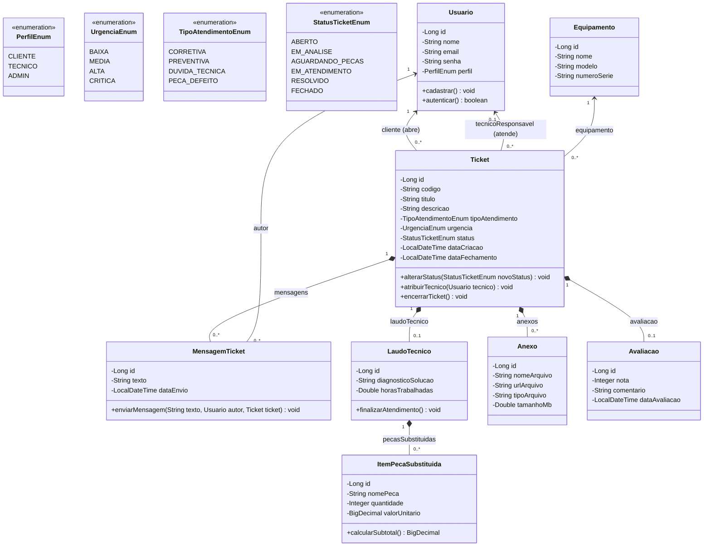

<div align="center">

# CENTRO UNIVERSITÁRIO CATÓLICA DE SANTA CATARINA
### CURSO DE BACHARELADO EM ENGENHARIA DE SOFTWARE
### DISCIPLINA DE PROGRAMAÇÃO WEB (5ª FASE)

---

# SISTEMA ASTEC
### Sistema de Gestão de Assistência Técnica Especializada
**Documentação Oficial e Backend – Etapa 1: Backend, Modelagem e Requisitos**


</div>

---

## 👥 Identificação da Equipe

| Integrante | Função / Papel |
|---|---|
| **Agenor Alvise** | Líder do Projeto / Modelagem JPA & Arquitetura Backend |
| **Felipe Santos** | Engenharia de Requisitos & Mapeamento de Entidades |
| **Henrique Cezar da Silveira** | Camada de Repositórios & Testes Automatizados |

- **Repositório Git:** (https://github.com/Agenorsc/sistema-astec)
- **Instituição:** Centro Universitário Católica de Santa Catarina (Católica SC)
- **Fase:** 5ª Fase - Engenharia de Software

---

## 1. Visão Geral do Projeto

### 1.1 Nome do Produto
**Sistema Astec** (Gestão de Assistência Técnica)

### 1.2 Declaração do Problema e Justificativa
A empresa **AGE Máquinas e Manutenção LTDA** necessita centralizar o registro e acompanhamento das solicitações de assistência técnica, atualmente realizadas por diferentes canais dispersos, como telefone, e-mail e WhatsApp. 

Essa descentralização acarreta perda de informações, dificuldade no rastreamento de prazos (SLA), falta de histórico consolidado de atendimentos em cada máquina industrial e ineficiência na alocação de técnicos especializados. 

O **Sistema Astec** propõe unificar e centralizar todo o ciclo de vida do suporte técnico em uma aplicação web moderna, provendo:
- Abertura padronizada de chamados com classificação e urgência;
- Canal de mensagens e anexos de fotos, vídeos e laudos dentro do próprio chamado;
- Fluxo de trabalho com controle de status em tempo real;
- Registro técnico de diagnósticos, horas trabalhadas e peças industriais substituídas;
- Avaliação da satisfação do cliente para melhoria contínua.

### 1.3 Público-Alvo e Objetivos do Sistema
- **Clientes da AGE Máquinas:** Responsáveis pela abertura, anexação de mídias, acompanhamento dos chamados das suas máquinas e avaliação pós-atendimento.
- **Técnicos e Administradores:** Responsáveis pela triagem, atribuição de técnicos de campo, elaboração de laudos técnicos, troca de peças e resolução dos tickets.

#### Objetivo Geral
Desenvolver um sistema web completo para centralizar e organizar o gerenciamento das solicitações de assistência técnica da AGE Máquinas, permitindo o registro, acompanhamento, tramitação de status e histórico das intervenções técnicas.

#### Objetivos Específicos
1. Permitir o cadastro e gerenciamento relacional de clientes e seus respectivos equipamentos industriais;
2. Prover abertura e consulta de chamados com controle de status e urgência;
3. Oferecer histórico interativo de mensagens entre cliente e suporte técnico;
4. Registrar laudos técnicos formais com levantamento de horas gastas e peças trocadas;
5. Garantir persistência relacional robusta com Spring Data JPA, validações de integridade e testes automatizados.

---

## 2. Especificação de Requisitos

### 2.1 Requisitos Funcionais (RF)

| ID | Nome do Requisito | Descrição Detalhada |
|---|---|---|
| **RF01** | Abertura de Chamado | O cliente pode abrir um ticket escolhendo o equipamento/máquina, tipo de atendimento (corretiva, preventiva, dúvida técnica, peça com defeito), título, descrição da falha e urgência. |
| **RF02** | Anexo de Mídias | O cliente e o técnico podem anexar fotos do equipamento, vídeos curtos do problema e documentos técnicos em PDF. |
| **RF03** | Atribuição de Técnico | O gestor pode visualizar a fila de chamados pendentes e atribuir um técnico ou equipe para cada ticket. |
| **RF04** | Status do Chamado | O sistema controla o fluxo do chamado pelos status: *Aberto*, *Em Análise*, *Aguardando Peças*, *Em Atendimento*, *Resolvido* e *Fechado*. |
| **RF05** | Chat/Histórico do Ticket | Canal de mensagens dentro do ticket para troca de informações e histórico contínuo entre cliente e técnico. |
| **RF06** | Notificações | Envio de e-mails ou alertas automáticos quando houver troca de status, novas mensagens ou atribuição de técnico. |
| **RF07** | Painel do Cliente | Tela para o cliente listar e filtrar seus próprios chamados por status, data e máquina. |
| **RF08** | Painel do Técnico/Admin | Central de atendimento para visualização e filtragem global de todos os chamados da empresa. |
| **RF09** | Laudo Técnico e Peças | O técnico registra o diagnóstico/solução aplicada, tempo de trabalho em horas e peças substituídas com cálculo de valores. |
| **RF10** | Avaliação do Atendimento | O cliente avalia o atendimento com nota de 1 a 5 estrelas e comentário após a resolução. |
| **RF11** | Reabertura de Ticket | O cliente pode reabrir um chamado encerrado em até 7 dias caso o problema no mesmo equipamento volte a ocorrer. |

### 2.2 Requisitos Não Funcionais (RNF)

| ID | Requisito Não Funcional | Especificação Técnica |
|---|---|---|
| **RNF01** | Tempo de Carregamento | O carregamento de telas e transições de status da API devem responder em no máximo 1,5 segundos. |
| **RNF02** | Disponibilidade | Operação 24 horas por dia, 7 dias por semana, com uptime garantido de no mínimo 99,5%. |
| **RNF03** | Controle de Acesso (RBAC) | Segregação de privilégios onde Clientes visualizam apenas seus tickets e Técnicos/Admins possuem visão global. |
| **RNF04** | Histórico e Auditoria | Toda troca de status, mensagem e laudo deve possuir carimbo de data/hora imutável para rastreabilidade. |
| **RNF05** | Limite de Anexos | Cada arquivo anexado pode ter no máximo 20 MB e passa por validação de extensão permitida (jpg, pdf, mp4). |
| **RNF06** | Acesso Mobile | Frontend responsivo compatível com tablets e smartphones para suporte aos técnicos em campo. |
| **RNF07** | Controle de SLA | Gestão de prazos máximos de primeira resposta e resolução definitiva de acordo com a urgência (Crítica, Alta, Média, Baixa). |
| **RNF08** | Proteção de Dados (LGPD) | Proteção e sigilo de dados sensíveis de contato e histórico industrial em conformidade com a LGPD. |
| **RNF09** | Padrões de Integração (RESTful) | Backend estruturado sob a arquitetura REST com payloads padronizados em JSON e códigos de status HTTP semânticos. |
| **RNF10** | Banco de Dados e Persistência | Os dados do sistema devem ser mapeados para um banco relacional usando Spring Data JPA. Nesta etapa, será utilizado o H2 em memória, com criação e atualização do esquema pelo Hibernate. Os dados são temporários e não permanecem após o encerramento da aplicação. |

---

## 3. Arquitetura e Modelagem de Dados

### 3.1 Diagrama de Classes UML



---

## 4. Dicionário de Dados

### Tabela: `tb_usuario`
| Campo | Tipo | Restrição | Descrição |
|---|---|---|---|
| `id` | BIGINT | PK, Auto Inc | Identificador único do usuário. |
| `nome` | VARCHAR(255) | Not Null | Nome completo. |
| `email` | VARCHAR(255) | Unique, Not Null | E-mail para autenticação/login. |
| `senha` | VARCHAR(255) | Not Null | Hash criptográfico da senha. |
| `perfil` | VARCHAR(50) | Not Null | Nível de acesso (CLIENTE, TECNICO, ADMIN). |

### Tabela: `tb_equipamento`
| Campo | Tipo | Restrição | Descrição |
|---|---|---|---|
| `id` | BIGINT | PK, Auto Inc | Identificador único do equipamento. |
| `nome` | VARCHAR(255) | Not Null | Nome comercial do maquinário. |
| `modelo` | VARCHAR(255) | Nullable | Modelo do equipamento industrial. |
| `numeroSerie` | VARCHAR(100) | Unique | Número de série para controle patrimonial. |

### Tabela: `tb_ticket`
| Campo | Tipo | Restrição | Descrição |
|---|---|---|---|
| `id` | BIGINT | PK, Auto Inc | Identificador único do chamado. |
| `codigo` | VARCHAR(50) | Unique, Not Null | Protocolo gerado para o cliente (ex: AST-20261001). |
| `titulo` | VARCHAR(255) | Not Null | Resumo do defeito relatado. |
| `descricao` | TEXT | Not Null | Descrição minuciosa da ocorrência. |
| `tipoAtendimento` | VARCHAR(50) | Not Null | Enum (CORRETIVA, PREVENTIVA, DUVIDA_TECNICA, PECA_DEFEITO). |
| `urgencia` | VARCHAR(50) | Not Null | Enum (BAIXA, MEDIA, ALTA, CRITICA). |
| `status` | VARCHAR(50) | Not Null | Enum (ABERTO, EM_ANALISE, AGUARDANDO_PECAS, EM_ATENDIMENTO, RESOLVIDO, FECHADO). |
| `dataCriacao` | TIMESTAMP | Not Null | Carimbo temporal de abertura. |
| `dataFechamento` | TIMESTAMP | Nullable | Carimbo temporal de encerramento. |
| `cliente_id` | BIGINT | FK, Not Null | Referência ao usuário solicitante (tb_usuario). |
| `tecnico_id` | BIGINT | FK, Nullable | Referência ao técnico responsável (tb_usuario). |
| `equipamento_id` | BIGINT | FK, Not Null | Referência ao equipamento vinculado (tb_equipamento). |

### Tabela: `tb_mensagem_ticket`
| Campo | Tipo | Restrição | Descrição |
|---|---|---|---|
| `id` | BIGINT | PK, Auto Inc | Identificador único da mensagem. |
| `texto` | TEXT | Not Null | Conteúdo textual da mensagem (chat). |
| `dataEnvio` | TIMESTAMP | Not Null | Data e hora do envio. |
| `ticket_id` | BIGINT | FK, Not Null | Ticket ao qual a mensagem pertence. |
| `autor_id` | BIGINT | FK, Not Null | Usuário autor da postagem. |

### Tabela: `tb_laudo_tecnico`
| Campo | Tipo | Restrição | Descrição |
|---|---|---|---|
| `id` | BIGINT | PK, Auto Inc | Identificador único do laudo técnico. |
| `diagnosticoSolucao` | TEXT | Not Null | Laudo de diagnóstico técnico e solução executada. |
| `horasTrabalhadas` | DOUBLE | Nullable | Quantidade de horas de mão-de-obra dedicadas. |
| `ticket_id` | BIGINT | FK, Unique, Not Null | Relação 1:1 obrigatória com `tb_ticket`. |

### Tabela: `tb_item_peca`
| Campo | Tipo | Restrição | Descrição |
|---|---|---|---|
| `id` | BIGINT | PK, Auto Inc | Identificador único do item de peça. |
| `nomePeca` | VARCHAR(255) | Not Null | Descrição da peça industrial substituída. |
| `quantidade` | INT | Not Null | Quantidade consumida. |
| `valorUnitario` | DECIMAL(10,2) | Not Null | Custo unitário da peça. |
| `laudo_tecnico_id` | BIGINT | FK, Not Null | Referência ao laudo que consumiu a peça. |

### Tabela: `tb_anexo`
| Campo | Tipo | Restrição | Descrição |
|---|---|---|---|
| `id` | BIGINT | PK, Auto Inc | Identificador único do anexo. |
| `nomeArquivo` | VARCHAR(255) | Not Null | Nome original do arquivo. |
| `urlArquivo` | VARCHAR(500) | Not Null | Caminho no bucket de armazenamento / S3. |
| `tipoArquivo` | VARCHAR(50) | Nullable | Extensão MIME (jpg, pdf, mp4). |
| `tamanhoMb` | DOUBLE | Nullable | Tamanho em megabytes para validação. |
| `ticket_id` | BIGINT | FK, Not Null | Ticket de origem do anexo. |

### Tabela: `tb_avaliacao`
| Campo | Tipo | Restrição | Descrição |
|---|---|---|---|
| `id` | BIGINT | PK, Auto Inc | Identificador único da avaliação. |
| `nota` | INT | Not Null | Escala de 1 a 5 estrelas. |
| `comentario` | VARCHAR(500) | Nullable | Feedback descritivo do cliente. |
| `dataAvaliacao` | TIMESTAMP | Not Null | Data e hora da avaliação. |
| `ticket_id` | BIGINT | FK, Unique, Not Null | Relação 1:1 obrigatória com `tb_ticket`. |

---

## 5. Como Executar o Projeto

### Pré-requisitos
- **JDK 25 LTS** instalado
- **Maven** (ou utilizar o wrapper `./mvnw` incluso)

### Passos de Execução
1. Clone ou acesse o diretório do projeto:
   ```powershell
   cd "C:\Sistema Astec"
   ```
2. Execute a aplicação via Maven Wrapper:
   ```powershell
   .\mvnw spring-boot:run
   ```
3. A aplicação estará ativa na porta `8080`:
   - **API REST Base:** `http://localhost:8080/api/tickets`
   - **Console H2 Database:** `http://localhost:8080/h2-console`
     - JDBC URL: `jdbc:h2:mem:astecdb`
     - Usuário: `sa`
     - Senha: *(em branco)*

### Execução dos Testes Automatizados
Para rodar a suíte completa de testes de repositório e consultas DTO:
```powershell
.\mvnw test
```

---

## 6. Endpoints da API REST (JSON no Navegador)

Teste das rotas da API direto no navegador ou no Postman/Insomnia:

- **Listar todos os Chamados:**
  - `http://localhost:8080/api/tickets`
- **Listar Usuários (Clientes, Técnicos, Admin):**
  - `http://localhost:8080/api/usuarios`
- **Listar Equipamentos industriais:**
  - `http://localhost:8080/api/equipamentos`
- **Estatísticas de Tickets por Máquina (Consulta DTO):**
  - `http://localhost:8080/api/tickets/estatisticas/equipamentos`
- **Estatísticas de Tickets por Status:**
  - `http://localhost:8080/api/tickets/estatisticas/status`
